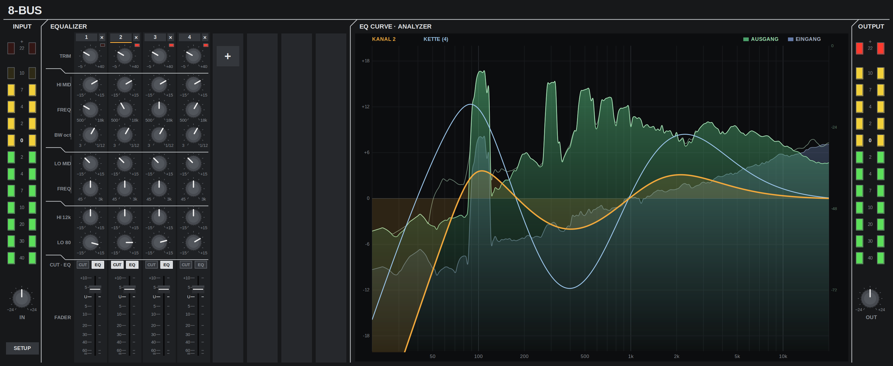

# 8-Bus

VST3-Kanalzug-Emulation eines analogen 8-Bus-Pults der 90er auf Schaltungsebene. Bis zu 8 Kanalzüge seriell pro Instanz.
VST3 channel-strip emulation of a 90s analog 8-bus console at circuit level. Up to 8 strips in series per instance.

[Deutsch](#deutsch) · [English](#english)

Rosa Rauschen + 100 Hz, 4 Kanäle seriell. Analyzer: Eingang/Ausgang, EQ-Kurve Kanal 2 und Gesamtkette. ·
Pink noise + 100 Hz, 4 strips in series. Analyzer: input/output, EQ curve of strip 2 and of the full chain.

  

  <a href="https://github.com/becauseofreasons/8-Bus/releases/download/v1.0.0/8-Bus-1.0.0-Windows.zip">Windows (x64 + x86)</a> ·
  <a href="https://github.com/becauseofreasons/8-Bus/releases/download/v1.0.0/8-Bus-1.0.0-Linux.zip">Linux (x86_64)</a>

| | |
|---|---|
| Version | 1.0.0 |
| Vendor | BecauseOfReasons |
| Format | VST3, `Fx\|EQ`, Stereo (Dual-Mono) |
| Plattformen / Platforms | Windows x64 + x86, Linux x86_64 |
| Latenz / Latency | 36 Samples (konstant / constant) |
| Lizenz / License | [MIT](LICENSE) |
| Download | [Releases](https://github.com/becauseofreasons/8-Bus/releases/latest) |

---

## Deutsch

### Signalfluss pro Kanalzug

| Stufe | Topologie | Regelbereich |
|---|---|---|
| Line-Eingang | Spannungsteiler, −9,1 dB | – |
| Vorverstärker | Diskretes Differenzpaar, Gain über Rg + Trim, Koppel-C 470 µF stromgrenzt (Ruhestrom 6,2 mA/Hälfte), Transimpedanzstufe | Trim −5 … +40 dB |
| Lo Cut | Sallen-Key-Hochpass 3. Ordnung (Tschebyscheff) | −3 dB @ 85 Hz, 18 dB/Okt |
| Lo Mid | Wien-Bandpass am nichtinvertierenden Eingang einer Summierstufe, feste Bandbreite (~2,1 Okt) | ±15 dB, 45 Hz … 3 kHz |
| Hi Mid | State-Variable-Bandpass, vollparametrisch | ±15 dB, 500 Hz … 18 kHz, BW 3 … 1/12 Okt |
| Hi / Lo | Baxandall-Shelving + Inverter | ±15 dB @ 12 kHz / 80 Hz |
| Fader | Fader + nichtinvertierende Nachverstärkung | ∞ … +10 dB |
| OL | 3 Spitzenwert-Abgriffe (Pre, EQ, Fader) auf Komparator | LED |

Zwischenstufen-Koppelkondensatoren als Hochpässe < 1 Hz. Ausgang: Hochpass 2. Ordnung bei 5 Hz (Kopplung Summe/Wandler).
Kalibrierung: 0 dBu = −18 dBFS.

### Implementierung

* **Filter:** Netzlisten der Originalschaltung, modifizierte Knotenanalyse (MNA) mit idealen Op-Amps (Nullor),
  diskretisiert nach DK-Methode (Trapezregel, ein Zustand pro Kondensator) zu Zustandsraum-Systemen.
  Koeffizienten werden bei Poti-Änderung neu berechnet; Potis mit realer Kennlinie (log 15 % für Frequenz, linear für Gain).
* **Verifikation:** Frequenzgänge gegen ein unabhängiges Python-MNA-Referenzmodell, Abweichung < 10⁻⁵ dB;
  DK-Diskretisierung gegen AC-Analyse; Bandgrenzen gegen Herstellerspezifikation.
* **Nichtlinearität:** Rail-Clipping je Op-Amp-Ausgang (4560-Modell, Soft-Knee ab 92 % der Schienenspannung),
  getrennte Schienen für Vorverstärker, EQ und Fader-Stufe. Stromgrenzung im Vorverstärker (Koppel-C-Aufladung → Gain-Pumpen).
* **Versorgung/Masse:** Lastabhängiger Rail-Sag (Innenwiderstand) und Masseresonanz (Bandpass 52 Hz, Q 2), gespeist aus
  Last- und Sättigungsstrom aller Stufen; Rückkopplung in den Eingang. Amplitude begrenzt auf 30 % der Eingangshüllkurve,
  Gate < 1 mV – keine Selbstoszillation, Ausklingen < 1 s. Skalierbar 0 … ×4 (×1 = typisches Pult). Pro Audiokanal getrennt.
* **Toleranzen:** Optional, R/C-Streuung und Gleichlauffehler der Tandem-Potis, Seed pro Instanz (im State gespeichert).
* **Oversampling:** 2× / 4× / 8×, polyphasiges Kaiser-FIR (36·L+1 Taps), Gruppenlaufzeit auf 36 Samples (Host-Rate) fixiert.
* **Echtzeit:** Keine Allokation im Audio-Thread, FTZ/DAZ, Parameterglättung im 32-Sample-Raster.
* **Parameter:** 95, alle automatisierbar (7 global + 11 je Kanalzug, gruppiert als Units „Kanal 1…8“).

### Analyzer

Hann-Fenster, Multi-Resolution-FFT (8192 Punkte < 250 Hz, 2048 Punkte > 500 Hz, Überblendung dazwischen),
Leistungsmittelung über ≥ 1/6 Oktave, Tilt 4,5 dB/Okt um 1 kHz, Attack 12 ms, Release 0,1 / 0,3 / 0,7 s,
Peak-Hold mit 6 dB/s Abfall, Bereich 60 / 90 / 120 dB, ~60 fps. Anzeige Pre/Post oder nur Post.

### Bedienung

* Kanalnummer: Auswahl für EQ-Kurve. Rechtsklick: Reset / Duplizieren / Entfernen. `+` / `×`: Kanal anfügen / entfernen.
* Regler: Drag (Shift = fein), Doppelklick = Default, Mausrad.
* IN / OUT: ±24 dB.
* SETUP: Oversampling, Toleranzen, Zoom (75–150 %), Presets, Bypass (latenzkompensiert), Netzteil/Masse, Analyzer-Optionen.

### Performance

1 Kern, Stereo, 48 kHz, 4× OS: 1 Kanalzug ≈ 6 %, 8 Kanalzüge ≈ 28 %. Bei 8× OS: ≈ 13 % / ≈ 50 %.

### Installation

`8-Bus.vst3` aus dem Release-ZIP nach
* Windows: `C:\Program Files\Common Files\VST3\` (Bundle enthält x64 und x86; 32-bit-Hosts: `C:\Program Files (x86)\Common Files\VST3\`)
* Linux: `~/.vst3/`

macOS wird nicht unterstützt.

### Build

Steinberg VST3 SDK 3.8 + VSTGUI, kein JUCE. CMake/Ninja; Windows per MinGW-w64-Cross-Compile.
Build, Tests (Kurvenreferenz, Engine, Host-Test, Steinberg-Validator 537/537): [vst3/README.md](vst3/README.md).
Schaltungsanalyse und Modellannahmen: [vst3/Analyse.md](vst3/Analyse.md).

### Lizenz

[MIT](LICENSE), Fremdsoftware: [THIRD_PARTY_NOTICES.md](THIRD_PARTY_NOTICES.md). Kein Bezug zu einem Pulthersteller.

---

## English

### Signal flow per strip

| Stage | Topology | Range |
|---|---|---|
| Line input | Voltage divider, −9.1 dB | – |
| Preamp | Discrete differential pair, gain via Rg + trim, 470 µF coupling cap current-limited (6.2 mA quiescent per side), transimpedance stage | Trim −5 … +40 dB |
| Low cut | 3rd-order Sallen-Key high-pass (Chebyshev) | −3 dB @ 85 Hz, 18 dB/oct |
| Lo mid | Wien band-pass at the non-inverting input of a summing stage, fixed bandwidth (~2.1 oct) | ±15 dB, 45 Hz … 3 kHz |
| Hi mid | State-variable band-pass, fully parametric | ±15 dB, 500 Hz … 18 kHz, BW 3 … 1/12 oct |
| Hi / Lo | Baxandall shelving + inverter | ±15 dB @ 12 kHz / 80 Hz |
| Fader | Fader + non-inverting make-up gain | ∞ … +10 dB |
| OL | 3 peak taps (pre, EQ, fader) into comparator | LED |

Inter-stage coupling caps as sub-1 Hz high-passes. Output: 2nd-order 5 Hz high-pass (bus/converter coupling).
Calibration: 0 dBu = −18 dBFS.

### Implementation

* **Filters:** netlists of the original circuit, modified nodal analysis (MNA) with ideal op-amps (nullors),
  discretized with the DK method (trapezoidal rule, one state per capacitor) into state-space systems.
  Coefficients are recomputed on pot changes; pots use real tapers (15 % log for frequency, linear for gain).
* **Verification:** frequency responses against an independent Python MNA reference model, deviation < 10⁻⁵ dB;
  DK discretization against AC analysis; band limits against the manufacturer's specifications.
* **Non-linearity:** rail clipping at every op-amp output (4560 model, soft knee above 92 % of the rail),
  separate rails for preamp, EQ and fader stage. Current limiting in the preamp (coupling-cap charging → gain pumping).
* **Supply/ground:** load-dependent rail sag (source resistance) and ground resonance (band-pass 52 Hz, Q 2), driven by
  load and saturation current of all stages and fed back into the input. Amplitude bounded to 30 % of the input envelope,
  gate below 1 mV – no self-oscillation, decay < 1 s. Scalable 0 … ×4 (×1 = typical console). Separate per audio channel.
* **Tolerances:** optional R/C spread and dual-gang pot mismatch, seed per instance (stored in the state).
* **Oversampling:** 2× / 4× / 8×, polyphase Kaiser FIR (36·L+1 taps), group delay fixed at 36 samples (host rate).
* **Real-time:** no allocation on the audio thread, FTZ/DAZ, parameter smoothing on a 32-sample grid.
* **Parameters:** 95, all automatable (7 global + 11 per strip, grouped as units "Kanal 1…8").

### Analyzer

Hann window, multi-resolution FFT (8192 points below 250 Hz, 2048 points above 500 Hz, crossfade in between),
power averaging over ≥ 1/6 octave, 4.5 dB/oct tilt around 1 kHz, attack 12 ms, release 0.1 / 0.3 / 0.7 s,
peak hold falling at 6 dB/s, range 60 / 90 / 120 dB, ~60 fps. Pre/post or post only.

### Controls

UI labels are German (*Kanal* = strip, *Kette* = chain, *Netzteil/Masse* = supply/ground, *aus/an* = off/on).

* Strip number: selects the strip for the EQ curve. Right-click: reset / duplicate / remove. `+` / `×`: add / remove strip.
* Knobs: drag (Shift = fine), double-click = default, mouse wheel.
* IN / OUT: ±24 dB.
* SETUP: oversampling, tolerances, zoom (75–150 %), presets, bypass (latency-compensated), supply/ground, analyzer options.

### Performance

One core, stereo, 48 kHz, 4× OS: 1 strip ≈ 6 %, 8 strips ≈ 28 %. At 8× OS: ≈ 13 % / ≈ 50 %.

### Installation

Copy `8-Bus.vst3` from the release ZIP to
* Windows: `C:\Program Files\Common Files\VST3\` (bundle contains x64 and x86; 32-bit hosts: `C:\Program Files (x86)\Common Files\VST3\`)
* Linux: `~/.vst3/`

macOS is not supported.

### Build

Steinberg VST3 SDK 3.8 + VSTGUI, no JUCE. CMake/Ninja; Windows via MinGW-w64 cross compile.
Build and tests (curve reference, engine, host test, Steinberg validator 537/537): [vst3/README.md](vst3/README.md) (German).
Circuit analysis and model assumptions: [vst3/Analyse.md](vst3/Analyse.md) (German).

### License

[MIT](LICENSE), third-party software: [THIRD_PARTY_NOTICES.md](THIRD_PARTY_NOTICES.md). Not affiliated with any console manufacturer.
